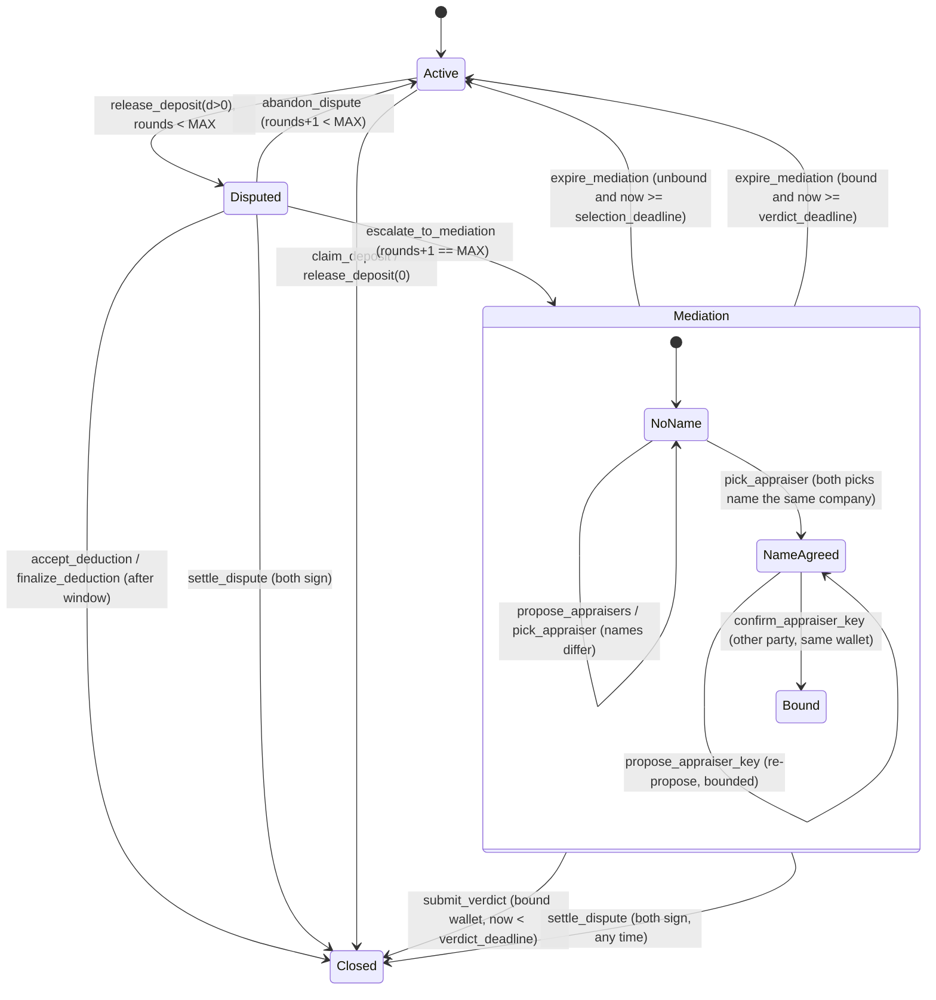

# Deposit mediation: on-chain appraiser arbitration (D2)

The escalation that sits behind the D1 settlement primitive (`docs/contracts/program-interface.md`
§5). D1 ends a contested deduction one of two ways: the tenant accepts it, or the tenant rejects it
and gets the whole deposit. The second is not a *decision* — it is the program admitting it cannot
tell who is right. D2 adds the missing decision-maker: a third-party appraiser (*rzeczoznawca*) the
two sides choose **together**, whose signed verdict the program pays out.

**Status: specified here (revision 2, open appraisers), implemented on branch `open-appraisers`. Not
deployed.** Only claim as working what is merged and deployed; see §10.

Revision 2 removes the admin-maintained appraiser registry that revision 1 had. The platform cannot
pre-register appraisers in every city, and a registry made the platform the gatekeeper of who may
arbitrate. Now **the two parties choose the appraiser, and only they do**: there is no `Appraiser`
account, no `register_appraiser` / `set_appraiser_active` / `set_default_appraiser`, no default
appraiser and no admin instruction anywhere in mediation. D2 was never deployed, so the `Dispute`
layout and the D2 error numbers change freely; `Lease` (218 bytes) does not (§8).

Program id is unchanged (`G4iMjveQKXztnGoxigAeWPrb5evT9yt6qaLkgQEp2dXm`) and this is an **in-place
upgrade** of the pre-D2 devnet program, not a fresh deploy — §8 is the compatibility argument.

## 1. The flow in one paragraph

The term ends. The landlord proposes a deduction (`release_deposit(d>0)`) and the lease goes
`Disputed`, exactly as in D1. The tenant rejects (`abandon_dispute`): the proposal is void and the
lease returns to `Active` with the claim clock resumed — **round 1**. The landlord may propose once
more. The tenant rejects again (`escalate_to_mediation`): this time the lease enters **`Mediation`**
and the deposit stays locked. Selection then has two phases under **one deadline**:

* **Phase 1 — agree on a company.** Each side proposes up to three appraisal *companies by name*,
  each with a fee. Each side picks one candidate from either list. When both picks name the same
  company, the name is agreed (and so is the fee).
* **Phase 2 — attach a wallet.** One party proposes the wallet that will sign for that company; the
  *other* party confirms the same wallet. Only then is the appraiser **bound**, and the verdict
  window starts.

The bound wallet submits a verdict; the program splits the deposit and closes the lease. If nothing
is bound by `selection_deadline`, or the bound wallet is silent past `verdict_deadline`, either party
expires the mediation, which returns the lease to `Active` and the deposit to the tenant through the
normal claim. Both parties together can `settle_dispute` at any time.

Two rejections, then it is no longer the parties' call. `MAX_DISPUTE_ROUNDS = 2`.

## 2. State machine



`Status::Mediation` is **appended** as the sixth variant (index 5), so `Proposed`, `Active`,
`Closed`, `Defaulted` and `Disputed` keep the values already written on chain.

### Why nothing is ever stuck

Every state has at least two exits, and in each state at least one needs only one party to act.

| State | Exit | Who must act | Needs a counterparty? |
|---|---|---|---|
| `Disputed` | `accept_deduction` | tenant | no |
| `Disputed` | `abandon_dispute` / `escalate_to_mediation` (inside the window) | tenant | no |
| `Disputed` | `finalize_deduction` (after the window) | landlord | no |
| `Disputed` | `settle_dispute` | both | yes |
| `Mediation`, unbound | `expire_mediation` (`now >= selection_deadline`) | landlord **or** tenant | no |
| `Mediation`, unbound | phase 1 / phase 2 to a binding (before `selection_deadline`) | both, in turn | yes |
| `Mediation`, bound | `submit_verdict` (`now < verdict_deadline`) | bound wallet | no |
| `Mediation`, bound | `expire_mediation` (`now >= verdict_deadline`) | landlord **or** tenant | no |
| `Mediation`, any | `settle_dispute` | both | yes |
| `Active`, term paid | `claim_deposit` (after the claim deadline) | tenant | no |
| `Active`, term paid | `release_deposit(0)` | landlord | no |

**There is no fallback appraiser.** Revision 1 let *anyone* bind an admin-designated default after
the selection window. Revision 2 has nothing to bind unless both parties agree, so the guarantee is
carried entirely by `expire_mediation`: a mediation that never binds expires, and the tenant then
takes the whole deposit through `claim_deposit`. That is the same trade-off D1 already documents —
with no oracle willing to speak, the program defaults to the tenant — and §10 states its sharp edge
plainly.

### Timing: one selection deadline, then one verdict window

`escalate_to_mediation` at time `M` sets a single deadline:

```
selection_deadline = M + SELECTION_WINDOW_SECS      (covers phase 1 AND phase 2)
verdict_deadline   = 0                              (unset until bound)
```

Everything that moves the selection forward — `propose_appraisers`, `pick_appraiser`,
`propose_appraiser_key`, `confirm_appraiser_key` — requires `now < selection_deadline`
(`SelectionWindowClosed`). Binding at time `B < selection_deadline` sets

```
verdict_deadline = B + VERDICT_WINDOW_SECS
```

and the appraiser always gets the full verdict window from the moment they are bound. Selection is
frozen from then on (`AppraiserAlreadyBound`).

`expire_mediation` is allowed exactly when

```
unbound:  now >= selection_deadline
bound:    now >= verdict_deadline
```

**The late-bind complement, proved.** Binding and expiry must never both be open and never both be
closed at an instant at which the mediation could still be bound:

| Instant | unbound: bind open? | unbound: expire open? | bound: expire open? |
|---|---|---|---|
| `now < selection_deadline` | yes | no (`SelectionWindowOpen`) | `now < verdict_deadline` ⇒ no (`VerdictWindowOpen`) |
| `now >= selection_deadline` | no (`SelectionWindowClosed`) | **yes** | only once `now >= verdict_deadline` |

The bind guard is `now < selection_deadline` and the unbound expiry guard is `now >= selection_deadline`
— exact complements, no gap and no overlap. So no confirmation can land at or after the moment
expiry becomes available, and none can re-arm a lapsed mediation (the S3 F2 failure of revision 1,
where a late pick pushed an already-owed expiry out by a full window). A binding at `B < selection_deadline`
takes away no entitlement, because the tenant had none yet. `verdict_deadline` is only ever written
by a binding, only once (`AppraiserAlreadyBound`), and always to `B + VERDICT_WINDOW_SECS` with
`B < selection_deadline`. The absolute worst-case lock-up is therefore

```
M + SELECTION_WINDOW_SECS + VERDICT_WINDOW_SECS
```

(revision 1 had `+ 2 * VERDICT_WINDOW_SECS`; there is no provisional deadline any more).
`submit_verdict` requires `now < verdict_deadline` and `expire_mediation` (bound) requires
`now >= verdict_deadline`: the same exact-complement boundary as before.

| Constant | Demo build (`--features demo`) | Release build |
|---|---|---|
| `CLAIM_WINDOW_SECS` | 3 s | 14 days |
| `DISPUTE_WINDOW_SECS` | 45 s | 14 days |
| `SELECTION_WINDOW_SECS` | **30 s** | **7 days** |
| `VERDICT_WINDOW_SECS` | **60 s** | **14 days** |

All four are `#[constant]`, so they land in the IDL and the app reads the value of the build it runs
against. `scripts/sync-idl.sh` refuses an IDL whose four values are not the demo set. The selection
window now has to fit two hand-offs including an out-of-band invitation to a person who may not have
an account yet; 7 days in a release build is meant for that, and 30 s in the demo is meant for a
stage.

## 3. Accounts

### `Lease` — one field changes meaning, the layout does not

`dispute_rejected: bool` becomes **`dispute_rounds: u8`** at the same offset (byte 217), so `Lease`
stays **218 bytes**. §8 has the compatibility argument. No other `Lease` field is added or moved.
`lease.disputed_at` is reused as "when the current dispute *or* mediation started" and stays the only
copy of that timestamp (§5).

### `Dispute` — PDA `[b"dispute", lease]`, 891 bytes

Created by `escalate_to_mediation`, paid for by the tenant, **closed on every exit** with the rent
going back to `lease.tenant`. There is no `Appraiser` account: everything the program knows about the
appraiser is on this one.

```rust
pub struct Candidate {
    pub name: [u8; MAX_NAME_LEN],   // 64; only [..name_len] is meaningful, display form (§4)
    pub name_len: u8,
    pub name_hash: [u8; 32],        // sha256(canonical name), the comparison key (§4)
    pub fee: u64,                   // base units of the lease mint; <= deposit / 10 at proposal
}

pub struct Dispute {
    pub lease: Pubkey,                                   // redundant with the seeds; kept for has_one
    pub landlord_candidates: [Candidate; MAX_CANDIDATES],// 3; only [..landlord_count] is meaningful
    pub tenant_candidates: [Candidate; MAX_CANDIDATES],
    pub landlord_count: u8,
    pub tenant_count: u8,
    pub landlord_pick: [u8; 32],                         // name_hash; all-zero = has not picked
    pub tenant_pick: [u8; 32],
    pub agreed_name_hash: [u8; 32],                      // all-zero = phase 1 not done
    pub agreed_fee: u64,                                 // the bound fee (§4)
    pub proposed_key: Pubkey,                            // all-zero = no wallet proposed yet
    pub key_proposer: Pubkey,                            // which party proposed it
    pub landlord_key_proposals: u8,                      // each party's own proposals, <= MAX_KEY_PROPOSALS_PER_PARTY
    pub tenant_key_proposals: u8,
    pub appraiser: Pubkey,                               // the bound wallet; all-zero = not bound
    pub selection_deadline: i64,
    pub verdict_deadline: i64,                           // 0 until bound
    pub bump: u8,
}
```

The all-zero value is "unset" throughout, the same convention `Config::issuer` uses. It cannot
collide with a real value: a SHA-256 of a non-empty name is never all-zero in practice, and the
all-zero *wallet* is refused by `propose_appraiser_key` (`InvalidAppraiserKey`).

There is no `Appraiser` account and `Config` is untouched.

**Known limitation.** `fee` is a fixed number of base units but a lease's mint is per lease. Two
mints with different decimals would read the same number differently. The per-lease cap
(`deposit / 10`) bounds the damage either way, and every mint in the demo has 6 decimals. A fee in
basis points of the deposit would be mint-agnostic and is the obvious follow-up.

## 4. Instructions

| Instruction | Signer | Effect |
|---|---|---|
| `abandon_dispute()` *(changed)* | tenant | round 1 rejection: `dispute_rounds += 1`, lease back to `Active`, claim clock resumed |
| `escalate_to_mediation()` *(new)* | tenant | `dispute_rounds += 1` to `MAX`, lease to `Mediation`, creates `Dispute`, sets `selection_deadline` |
| `release_deposit(d)` *(changed)* | landlord | `d > 0` allowed while `dispute_rounds < MAX_DISPUTE_ROUNDS`; `d == 0` always |
| `propose_appraisers(candidates)` | landlord or tenant | phase 1: records 1–3 `(name, fee)` candidates for the signer's side; once per side |
| `pick_appraiser(name)` | landlord or tenant | phase 1: records the signer's pick; when both picks name the same company, the name and fee are agreed |
| `propose_appraiser_key(wallet)` | landlord or tenant | phase 2: proposes the wallet for the agreed company; at most two proposals per party |
| `confirm_appraiser_key(wallet)` | the party that did **not** propose | phase 2: confirms the same wallet; binds the appraiser and starts the verdict window |
| `submit_verdict(deduction)` | the bound wallet | inside the verdict window: pays out per §6, closes the lease and the `Dispute` |
| `expire_mediation()` | landlord or tenant | unbound and past `selection_deadline`, or bound and past `verdict_deadline`: lease back to `Active`, claim clock resumed, `Dispute` closed |
| `settle_dispute(d)` *(changed)* | tenant **and** landlord | accepts `Disputed` **or** `Mediation`; closes the `Dispute` when there is one |

`accept_deduction` and `finalize_deduction` are unchanged and remain `Disputed`-only. There are no
admin instructions in mediation.

### Phase 1: names

`propose_appraisers(candidates: Vec<CandidateInput { name: String, fee: u64 }>)` — 1 to 3 entries.
Per candidate:

* **Name validation, on chain.** The name is trimmed, internal whitespace runs (including NBSP) are
  collapsed to one space, and the result must be **1 to 64 bytes of valid UTF-8 with no control
  characters** (which excludes NUL) **and no invisible code points**: zero-width, format and bidi
  characters (U+200B–200F, U+202A–202E, U+2060–2064, U+2066–206F, U+FEFF, U+180E, U+00AD, the
  reachable Cf blocks by explicit range, and the variation selectors U+FE00–FE0F and
  U+E0100–E01EF) are refused, so two rows a person cannot tell apart cannot
  carry different hashes. Violations are `InvalidAppraiserName`. The stored `name` is that normalised display
  form.
* **Canonical form for comparison.** `canonical = ascii_lowercase(display)`; `name_hash =
  sha256(canonical)` is stored next to the name and is the **only** thing compared. So `"Acme  Wycena"`
  and `"acme wycena "` are the same company. Only ASCII is case-folded and no Unicode normalisation
  is applied: `"Wycena Łódź"` and `"WYCENA ŁÓDŹ"` are *different* companies to the program. That costs
  liveness only (a side can always pick the other side's candidate exactly as spelled, which is how
  the two converge). **What remains, and is disclosed (§10 item 3):** visually confusable *visible*
  letters (Latin vs Cyrillic `a`) are still distinct hashes, so a name is an assertion the parties
  check off chain, never something the program verifies.
  **U+200C and U+200D (zero-width non-joiner / joiner) are blocked as a deliberate trade-off:** they
  have legitimate uses in some scripts but none in the Polish names this is built for, and allowing
  them would reopen invisible duplicates.
* **Fee cap.** `fee <= deposit / APPRAISER_FEE_CAP_DIVISOR` at proposal (`FeeAboveCap`). The verdict
  still clamps (`verdict_split` is unchanged), so this is a UX gate, not the safety property.
* Candidates are distinct **within** a side by `name_hash` (`DuplicateCandidate`); across sides they
  need not be — overlap is agreement arriving early.
* Once per side (`CandidatesAlreadyProposed`). Only while unbound and `now < selection_deadline`.

`pick_appraiser(name: String)` canonicalises `name` and requires its hash to be in
`landlord_candidates ∪ tenant_candidates` (`CandidateNotProposed`). Picking from the other side's
list is the intended way to converge; a side may change its pick while the name is not agreed; a side
that proposed nothing may still pick. When `landlord_pick == tenant_pick` (both non-zero):

```
agreed_name_hash = that hash
agreed_fee       = min(fee of every candidate on either side with that hash)
```

**If both sides proposed the same company with different fees, the lower fee wins.** Either party can
therefore lower the fee by listing the same name cheaper, and the appraiser who is later invited must
check the fee before accepting (§10). After this, `propose_appraisers` and `pick_appraiser` fail with
`NameAlreadyAgreed`.

If neither side proposes anything there is nothing to pick; the mediation resolves through
`settle_dispute` or expires.

### Phase 2: the wallet

The program cannot know which key belongs to "Acme Wycena", and a name cannot be checked against a
wallet. So the link is made by **two matching calls**, one from each party, exactly as phase 1 is:

* `propose_appraiser_key(wallet)` — either party. Requires: name agreed (`NameNotAgreed`), unbound,
  `now < selection_deadline`, `wallet` non-zero (`InvalidAppraiserKey`), **`wallet` is neither
  `lease.landlord` nor `lease.tenant`** (`NotMediationParty`), and the **signer's own** proposal
  budget not spent (`MAX_KEY_PROPOSALS_PER_PARTY` = 2, `KeyProposalsExhausted`). Sets `proposed_key =
  wallet`, `key_proposer = signer` and spends one of the signer's two proposals.
* `confirm_appraiser_key(wallet)` — the party that is **not** `key_proposer` (`CannotConfirmOwnProposal`).
  Requires a proposal (`NoKeyProposed`), `wallet == proposed_key` (`KeyMismatch`), unbound,
  `now < selection_deadline` (`SelectionWindowClosed`), the party exclusion again (the same check on
  the money-adjacent step), and then **binds**: `appraiser = wallet`, `verdict_deadline = now +
  VERDICT_WINDOW_SECS`, selection frozen.

Why `confirm` takes the wallet as an argument and does not just confirm "whatever is proposed": a
proposer who swaps the key in the same slot as the other party's confirmation cannot bind a wallet
the confirmer did not look at. The confirmation fails with `KeyMismatch` instead.

**Grief bounds.** Either party may propose a different key until confirmed — that is how the
parties switch. Each party has **its own budget of two proposals** (`MAX_KEY_PROPOSALS_PER_PARTY`,
an IDL constant), tracked per party, so one party can never burn the other's budget: whatever the
first party does, the other can always counter-propose, and when both budgets are spent (four
proposals in all) the last proposal is final and its recipient can confirm it or let the mediation
expire. (An earlier draft shared one counter of four; the party landing the fourth proposal would
then have chosen the only confirmable wallet. Review G4.) Nothing here extends any deadline: all of
it is inside `selection_deadline`. A party who refuses to confirm does not stall anything — they
simply decline to bind, and the mediation expires (§10 on who that favours).

The budgets are symmetric, but **whoever proposes last owns the only confirmable key at
exhaustion**: the other party can confirm it or let the mediation expire, never substitute their
own. That is the anti-sockpuppet property (a key only binds with the other party's explicit
consent), not a defect.

### How the wallet reaches the parties: the invitation, which proves nothing

The program sees a name and, separately, a wallet. Something off chain has to get the second one
from the appraiser to the two parties, and the backend's **invitation** is that carrier and *only*
that (`backend/src/invites.ts`, `docs/env-checklist.md`):

1. The name is agreed on chain. Either party then calls `POST /api/invites {lease, companyName,
   email}`. The backend refuses unless the caller is the landlord or the tenant of that lease, the
   lease is in `Mediation`, nothing is bound yet, and `sha256(ascii_lowercase(display_name(
   companyName)))` **equals `dispute.agreed_name_hash`** — so an invitation can only ever name the
   company the parties actually agreed on.
2. The appraiser opens the e-mailed link, signs in (the ordinary wallet session; an embedded wallet
   is created on first login) and calls `POST /api/invites/:token/claim`, which records *their
   session's* wallet. The token is single-use, bound to lease + name hash, and expires no later than
   `selection_deadline`. A lease party is refused as the claimant, since the program would refuse
   them anyway.
3. Both parties read that wallet (`GET /api/invites?lease=…`) and each calls
   `propose_appraiser_key` / `confirm_appraiser_key` **themselves**.

**None of this is an authorisation.** The backend cannot bind an appraiser, submit a verdict, choose
the name or end a mediation; step 3 is two human confirmations and the program's guarantee remains
exactly "both parties confirmed this wallet". If the e-mail is intercepted, or the backend lies
about the claimed wallet, the parties will confirm a key that is not the company's and the program
cannot tell — which is §10 item 3, stated here as the mechanism rather than as a caveat. Neither
party's e-mail address is readable through the API.

Because the whole flow is an off-chain convenience, nothing depends on it: the parties can obtain
the wallet any way they like and call phase 2 directly, and a backend that is down costs liveness
only — the mediation then expires under the usual rule.

### Phase 3: the verdict, and the appraiser's token account

`submit_verdict(deduction)` is signed by `dispute.appraiser` and goes through `close_with_fee`
unchanged (§7), with `fee = dispute.agreed_fee`. There is no appraiser record to look up.

**Payability: the verdict transaction creates the appraiser's token account.** `appraiser_ata`
remains a required, initialised account (`token::mint = mint, token::authority = appraiser`), and the
client **must** put an idempotent create-associated-token-account instruction for it *before*
`submit_verdict` in the same transaction, paid by the sponsor/fee payer. The appraiser's wallet is
brand new (an embedded wallet created at login) and holds neither a token account nor SOL, so rent
has to come from the sponsor, and a create-idempotent in the same transaction is safe to repeat.

Why that and not `init_if_needed` in the program: `SubmitVerdict` is already the widest account list
in the program and was the SBF stack-frame overflow of S3 F1; adding the payer, the system program
and the associated-token program, plus the init code, spends stack on the one instruction that moves
the money, to save the client one instruction. Why not requiring the account at confirm: the
appraiser's account for the lease's mint is not the parties' to create, and a requirement there
would add a dependency on state the appraiser can undo (close it) afterwards. The failure mode of
forgetting the instruction is loud — `AccountNotInitialized` at validation, nothing moves, no fee is
lost — and a pinned test proves it; funds are never stranded because `expire_mediation` and
`settle_dispute` are open regardless.

**What the sponsor had to be taught to allow.** The backend's central sponsor invariant is that the
fee payer may appear *only* as the message fee payer and never inside an instruction — that slot is
writable and signed, so a reference to it is enough to drain the key. A create-ATA names its payer
in exactly that way, so this shape was refused outright until
`backend/src/txinspect.ts:sponsorFundedAtaInstructions` carved out one narrow exception for it. The
carve-out is structural, not a trust decision: the instruction must be `CreateIdempotent` with no
trailing data and six accounts; the fee payer may occupy only the payer slot; the account created,
its owner and its mint must be **the same accounts the verdict instruction uses** as `appraiser_ata`,
`appraiser` and `mint`; the owner must sign; it must precede the verdict; and there may be at most
one. Since the associated-token program derives the address from (owner, mint, token program) and
the transaction is atomic, the consequence is that **no rent leaves the sponsor unless a valid
verdict lands in the same transaction** — the exposure is one token-account rent per lease that
actually reaches a verdict. The rent is not counted by the sponsor's fee caps, which is recorded in
`docs/env-checklist.md`.

## 5. The claim clock

Unchanged in principle: **time the deposit spends unavailable is added to `claim_pause_secs`, so the
tenant waits exactly as long as they would have without any dispute.**

| Transition | Effect on `claim_pause_secs` |
|---|---|
| `release_deposit(d>0)` → `Disputed` | none; `disputed_at = now` |
| `abandon_dispute` → `Active` | `+= now - disputed_at`, `disputed_at = 0` |
| `escalate_to_mediation` → `Mediation` | `+= now - disputed_at` (the `Disputed` stretch), then `disputed_at = now` (mediation starts) |
| `expire_mediation` → `Active` | `+= now - disputed_at` (the `Mediation` stretch), `disputed_at = 0` |
| any `Closed` exit | irrelevant; the lease is over |

Each stretch is counted once, on the transition that ends it. `claim_deposit` requires
`Status::Active`, so it is blocked throughout `Disputed` and `Mediation`.

## 6. The fee rule: loser pays, out of the deposit

The appraiser is paid from the deposit. There is **no second escrow and no new custody**.

```
fee     = min(dispute.agreed_fee, deposit / 10)   # per-lease cap, integer division
d       = the verdict deduction, 0 <= d <= deposit
```

**Landlord won** (`2*d > deposit`) — the tenant pays:

```
fee_paid  = min(fee, deposit - d)               # cannot take more than the refund holds
to_tenant = deposit - d - fee_paid
to_landlord = d
```

**Tenant won** (`2*d <= deposit`) — the landlord pays, as far as their share reaches:

```
from_landlord = min(fee, d)
from_tenant   = fee - from_landlord             # the remainder, paid last
to_landlord   = d - from_landlord
to_tenant     = deposit - d - from_tenant
fee_paid      = fee
```

In both branches `to_tenant + to_landlord + fee_paid == deposit` exactly and the vault drains to
zero. The split is a pure function (`verdict_split(deposit, deduction, fee)`) with Rust unit tests;
**it is unchanged by revision 2**, as are its tests.

**Known limitation.** A verdict of `d = 0` is a total win for the tenant, and the tenant still pays
the fee — the landlord's share is zero and the fee can only come out of the deposit. Fixing it needs
a dual fee escrow, a second custody path (cut line 1).

**Second limitation: the appraiser's pay depends on the number they sign.** In the landlord-won
branch `fee_paid = min(fee, deposit - d)`, so for `d > deposit - fee` the appraiser is paid less than
the fee (at `d = deposit`, nothing). A fee-maximising appraiser has a stake against awarding the
landlord the last `fee` of the deposit. The clamp is deliberate and conservation holds either way.

**Counters on a `d = 0` verdict.** `deposits_returned_full` is credited only when the tenant actually
received the whole deposit (`to_tenant == deposit`), not when the verdict number is zero.
`last_deposit_return_bps` follows the verdict, so a `d = 0` verdict reads as 10000 while the tenant's
net is `deposit - fee`. Reputation records the **verdict**, not the fee.

## 7. Payout path

`submit_verdict` does **not** introduce a new way to move money. `pay_out_vault` has a third,
optional recipient and `close_with_deduction` keeps its signature, so the four existing callers are
untouched:

```
close_with_deduction(..., deduction)              ->  close_with_fee(..., deduction, None, 0)
close_with_fee(..., deduction, Some(ata), fee)    ->  verdict_split + three PDA-signed transfers
                                                      + record_deposit_outcome + Status::Closed
```

The vault's only authority is still the lease PDA. The appraiser signs the *verdict*; they never gain
authority over the vault. Revision 2 changes only what is passed as `fee` (`dispute.agreed_fee`).

## 8. Upgrade compatibility

This is an **in-place `solana program deploy`** over the live devnet program, which still runs the
**pre-D2** program: D2 (either revision) has not been deployed anywhere and local chains reset. So
the `Dispute` layout and the D2 error numbering of revision 1 never reached a chain and are free to
change. What must hold against the *deployed* program:

1. **`dispute_rejected: bool` → `dispute_rounds: u8` is byte-identical.** Both occupy byte 217;
   Borsh encodes `false`/`true` as `0x00`/`0x01`. An existing lease deserialises with
   `dispute_rounds ∈ {0, 1}`, and `Lease` stays 218 bytes. A Rust fixture test pins it.
2. **`Status::Mediation` is appended.** Variant indexes 0–4 are unchanged.
3. **`Dispute` is a new PDA** and cannot collide with anything already allocated. No existing account
   is resized, and `Config` is deliberately **not** touched.

**Behaviour change on existing leases, intended.** A lease that carries `dispute_rejected = true`
reads as `dispute_rounds = 1`, which under `MAX_DISPUTE_ROUNDS = 2` means the landlord may propose
*one more* deduction where the old program refused all of them. `release_deposit(0)` remains
available throughout.

**Sequencing: ship the app before the upgrade.** On an old lease with `dispute_rejected = true`
(now `dispute_rounds = 1`), `abandon_dispute` is refused and the tenant's only rejection is
`escalate_to_mediation`, which the currently deployed app has no button for. Upgrade the program only
together with, or after, an app that calls `escalate_to_mediation`, or confirm that no devnet lease
is sitting at `dispute_rejected = true`.

**The upgrade is one-way.** A lease that reaches `dispute_rounds = 2` stores `0x02` at byte 217,
which the old program would reject as an invalid bool. Only roll forward.

Error codes: the pre-D2 numbers (≤ 6037) are unchanged, and `DisputeAlreadyRejected` (6034) is
**renamed in place** to `DisputeRoundsExhausted`. Everything from 6038 is D2-only and, since D2 was
never deployed, was re-laid out in revision 2 (the registry errors are gone, new ones are appended);
**take the numbers from the IDL, not from revision 1.**

## 9. Errors

D2 errors, in IDL order (numbers from 6038 are in the IDL):

| Error | Raised when |
|---|---|
| `NotMediationParty` | the signer is neither `lease.landlord` nor `lease.tenant`; or a proposed/confirmed appraiser wallet **is** one of them; or `submit_verdict` is signed by one |
| `WrongDisputeRound` | `abandon_dispute` at the last round, or `escalate_to_mediation` before it |
| `AppraiserAlreadyBound` | any selection instruction after an appraiser is bound |
| `AppraiserNotBound` | `submit_verdict` with nothing bound |
| `NotBoundAppraiser` | `submit_verdict` signed by someone other than `dispute.appraiser` |
| `CandidatesAlreadyProposed` | a side proposing twice |
| `DuplicateCandidate` | the same canonical name twice in one side's list |
| `CandidateNotProposed` | a pick that is in neither list |
| `SelectionWindowOpen` | `expire_mediation` on an unbound dispute before `selection_deadline` |
| `VerdictWindowOpen` | `expire_mediation` on a bound dispute before `verdict_deadline` |
| `VerdictWindowClosed` | `submit_verdict` at or after `verdict_deadline` |
| `DisputeAccountRequired` | `settle_dispute` in `Mediation` without the `Dispute` account |
| `UnexpectedDisputeAccount` | `settle_dispute` in `Disputed` *with* a `Dispute` account |
| `SelectionWindowClosed` | `propose_appraisers`, `pick_appraiser`, `propose_appraiser_key` or `confirm_appraiser_key` at or after `selection_deadline` |
| `InvalidAppraiserName` | a name that is empty, over 64 bytes after normalisation, not UTF-8, or contains a control character |
| `NoCandidates` | `propose_appraisers` with zero or more than `MAX_CANDIDATES` entries |
| `FeeAboveCap` | a candidate fee above `deposit / 10` |
| `NameAlreadyAgreed` | phase 1 instructions after the company is agreed |
| `NameNotAgreed` | `propose_appraiser_key` before both picks match |
| `InvalidAppraiserKey` | an all-zero wallet |
| `KeyProposalsExhausted` | a third proposal from the same party |
| `NoKeyProposed` | `confirm_appraiser_key` with nothing proposed |
| `CannotConfirmOwnProposal` | `confirm_appraiser_key` by `key_proposer` |
| `KeyMismatch` | `confirm_appraiser_key(wallet)` where `wallet != proposed_key` |

Removed (registry/default only): `AppraiserInactive`, `AppraiserNotDefault`, `InvalidAppraiser`,
`BindingWindowClosed` (renamed `SelectionWindowClosed`).

### Two of these are defence in depth the state machine cannot reach

* **`NotMediationParty` in `submit_verdict`.** To get that far, `dispute.appraiser` must equal the
  signer, and the only instruction that can set it, `confirm_appraiser_key`, already refuses a party
  wallet (as does `propose_appraiser_key`). The check stays because the money path should not depend
  on those two instructions having been the only route in.
* **`UnexpectedDisputeAccount` in `settle_dispute`.** A lease can never be `Disputed` while its own
  `Dispute` account exists, and another lease's account fails Anchor's seed check. **It is
  unreachable only because `dispute_rounds` stays at the cap after `expire_mediation`.** If
  `MAX_DISPUTE_ROUNDS` or that rule changes (cut line 3 sets it to 1), re-check this claim.

## 10. Trust, and what to say about it

**The appraiser is an oracle.** The program cannot make a real appraisal company look at a flat, and
it cannot check that the number they sign reflects any damage. What it does is constrain *who* may
speak and *when*. The disclosure list, in the order a judge would ask:

1. **The appraiser is chosen by the parties, not by the platform.** There is no registry, no
   default appraiser, no admin instruction in mediation. The platform cannot install an arbiter, cannot
   suspend one, and cannot end a mediation. (Revision 1 disclosed that it could; that reach is gone.)
2. **Only a wallet both parties agreed on can speak.** A verdict is accepted only from the wallet
   that one party proposed and the *other* party confirmed (`confirm_appraiser_key`), after both had
   already agreed on a company name. A party cannot bind a sockpuppet alone: **collusion between one
   party and a sockpuppet appraiser needs the other party's consent to bind.** The consent is only as
   good as the other party's understanding of whose key it is (item 3).
3. **The link between a company name and a wallet is an assertion the parties confirm out of
   band.** The program sees a name string and, separately, a wallet; it cannot check that they belong
   together. Off chain, the app/backend carries an invitation (an e-mail link) from the parties to the
   appraiser and the wallet the appraiser creates at login reaches both parties' apps; each party then
   confirms it. If the e-mail is intercepted or the app shows the wrong address, the parties will
   confirm a key that is not the company's, and the program cannot tell. The program's guarantee is
   exactly "both parties confirmed this wallet", not "this wallet is Acme Wycena".
4. **The appraiser may not be a party to the lease** — checked on the wallet at proposal, at
   confirmation and at verdict. A name cannot be checked (the program cannot know that "Acme Wycena" is
   the landlord's company); that is what item 2 is for.
5. **Fee stake.** The appraiser's pay depends on the verdict (§6) and is capped at a tenth of the
   deposit. And the fee is the *lower* of two proposals for the same name (§4): either party can lower
   it by listing the same company cheaper, so the appraiser must read the fee before accepting.
6. **Exactly one verdict per dispute** (`submit_verdict` closes the lease); a verdict cannot be moved
   to another lease (the `Dispute` PDA is seeded by the lease, the vault is signed by the lease PDA);
   the verdict is bounded by `0 <= deduction <= deposit`; an appraiser who stays silent decides
   nothing.
7. **The name is on chain.** Names are public. Use a company name, not a person's: a sole trader's
   name is personal data, and the chain cannot forget it.
8. **There is no backend-held appraiser key.** The appraiser signs with their own wallet. (The demo
   may use a throwaway wallet operated by whoever runs the demo; that is not something the program can
   see or depends on.) This is now true of the backend as well as of the program: the registry, the
   `APPRAISERS` directory and the verdict console that held appraiser keys behind
   `VERDICT_CONSOLE_TOKEN` are all removed, so no key the platform holds can decide a deposit. What
   the backend carries instead is the invitation described in §4, which authorises nothing.

**Expiry strictly dominates any verdict for a rational tenant.** Stalling costs the tenant nothing
and returns the whole deposit with no fee (`expire_mediation` then `claim_deposit`); any verdict
costs them at least the appraiser's fee and possibly a deduction. So mediation runs only with a
cooperative tenant — one who wants a neutral decision more than the free option of stalling. The
roadmap mitigations below (a bond forfeited by the stalling side, an opt-in directory that makes
cooperation cheap) exist to change that arithmetic; none is built.

**The sharp edge of having no fallback — say it before a judge finds it.** **Mediation binds only
if both parties cooperate; a party who declines forfeits to the status quo, which is a full refund to
the tenant.** There is no default appraiser, so a mediation that never binds expires, and the tenant
takes the whole deposit. The party who benefits from that outcome — the tenant — can decline to
pick or to confirm, and the landlord has no on-chain remedy; the landlord's levers are the permanent
record of the rejections, `mark_default` during the term, and `settle_dispute`.

This is **no worse for the landlord than D1**, where a rejected deduction already ended in a full
tenant refund: mediation does not take anything away, it gives a *cooperative* tenant a way to a fair
split decided by someone neutral. The stall outcome is pinned by a test (§11, item 6). Decided and
accepted by the product owner; stated here so it is a decision rather than a discovery.

Roadmap, in the order it would matter: an **optional opt-in appraiser directory** as a convenience
(parties may pick from it; the program never depends on it), a **bond the stalling side forfeits**
(slashing for declining to pick or confirm), a bond the appraiser posts and can be slashed against,
an appeal window before the payout settles, several appraisers with a median verdict, and a public
appraiser reputation record. None of them is built.

## 11. What the tests must pin

Each a named test; the mocha suite is written against these.

1. **Conservation** — in every terminal path the vault drains exactly to `tenant + landlord +
   fee_paid`, never more than `deposit_amount`.
2. **No stuck state** — for `Disputed` and for `Mediation` (unbound, name-agreed with a proposal
   pending, bound), at least one exit that does not depend on the counterparty and `settle_dispute`.
3. **Authority** — only the bound wallet can submit; a party's wallet is refused as an appraiser at
   propose, confirm and verdict; the proposer cannot confirm their own proposal; a confirmation of a
   different wallet fails; one verdict per dispute; a verdict cannot be replayed against another lease.
4. **Candidate limits** — 1–3 per side, distinct by canonical name, once per side, fee cap, name
   validation (empty, 65 bytes, control char, NUL, zero-width/format/bidi code points; invalid
   UTF-8 cannot be sent by any client and is guaranteed by Borsh, not by `display_name`), canonicalisation (case and
   whitespace), lower-fee-wins.
5. **Key phase limits** — two proposals per party (one party cannot exhaust the other's; the other
   can always counter; both spent ⇒ no more proposals and the last stays confirmable); no proposal before the name is agreed or after
   binding; no bind after `selection_deadline`.
6. **The stall outcome** — a tenant who never picks (or never confirms) leaves the mediation to
   expire at `selection_deadline`, the lease returns to `Active`, and `claim_deposit` pays the tenant
   the whole deposit; the same holds when the landlord stalls.
7. **The late-bind complement** — at `now >= selection_deadline`, `propose`/`pick`/`confirm` fail with
   `SelectionWindowClosed` and `expire_mediation` succeeds; just before it, the reverse; a bound
   mediation's expiry is `verdict_deadline` and cannot be re-armed.
8. **Payability** — `submit_verdict` with an uncreated `appraiser_ata` fails loudly and moves nothing;
   with a create-idempotent in the same transaction (sponsor pays rent) it pays the fee.
9. **Round limits** — a third `release_deposit(d>0)` is refused; `abandon_dispute` and
   `escalate_to_mediation` each refuse the other's round; `dispute_rounds` never decrements.
10. **Claim clock** — the `Disputed` and `Mediation` stretches are each added exactly once.
11. **Compatibility** — raw bytes written by the pre-D2 program deserialise as `dispute_rounds = 1`
    and `0`; `8 + Lease::INIT_SPACE` is still 218.

Plus the pure-function Rust tests: `verdict_split`, name normalisation and hashing, candidate
membership, `agreed_fee` selection, and the deadline arithmetic.

## 12. Cut lines

In this order, if time runs out. Each is a small, local change:

1. **The fee rule.** Pass `None` for the fee everywhere, drop `appraiser_ata` and the candidate `fee`,
   and say the appraiser's fee is settled off chain.
2. **Phase 2.** Not recommended — it is the only protection against a one-sided sockpuppet.
3. **The second round.** `MAX_DISPUTE_ROUNDS = 1`: `abandon_dispute` becomes unreachable and the first
   rejection goes straight to `Mediation`.

**Never cut:** conservation, the appraiser authority checks, `expire_mediation`, the compatibility
fixture, and the independent review of the money path before any deploy.
