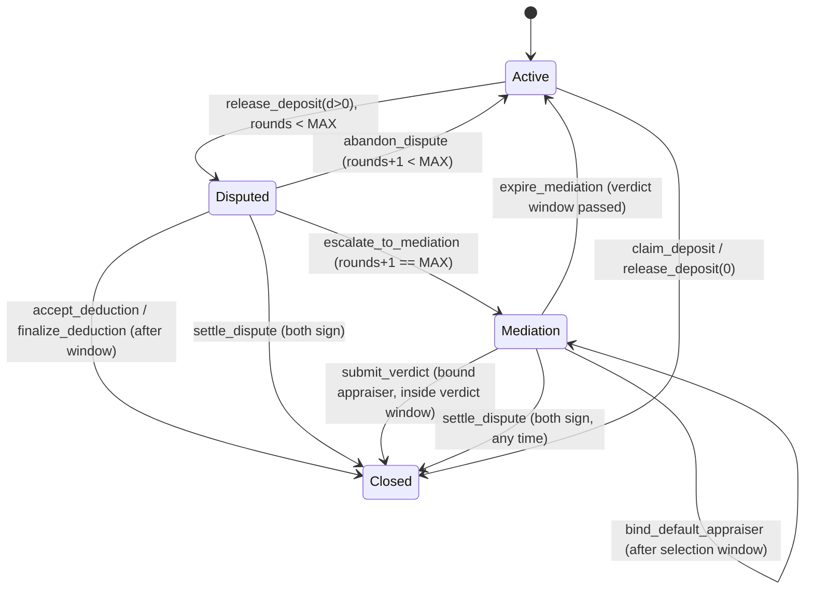

# Deposit mediation: on-chain appraiser arbitration (D2)

The escalation that sits behind the D1 settlement primitive (`docs/contracts/program-interface.md`
§5). D1 ends a contested deduction one of two ways: the tenant accepts it, or the tenant rejects it
and gets the whole deposit. The second is not a *decision* — it is the program admitting it cannot
tell who is right. D2 adds the missing decision-maker: a third-party appraiser (*rzeczoznawca*) the
two sides choose together, whose signed verdict the program pays out.

**Status: specified here, implemented on branch `d2-mediation`. Not deployed.** Only claim as
working what is merged and deployed; see §10.

Program id is unchanged (`G4iMjveQKXztnGoxigAeWPrb5evT9yt6qaLkgQEp2dXm`) and this is an **in-place
upgrade**, not a fresh deploy — §8 is the compatibility argument.

## 1. The flow in one paragraph

The term ends. The landlord proposes a deduction (`release_deposit(d>0)`) and the lease goes
`Disputed`, exactly as in D1. The tenant rejects (`abandon_dispute`): the proposal is void and the
lease returns to `Active` with the claim clock resumed — **round 1**. The landlord may propose once
more. The tenant rejects again (`escalate_to_mediation`): this time the lease enters
**`Mediation`** and the deposit stays locked. Each side names up to three appraisal companies from
an on-chain registry; each then picks one *from either list*, and the same pick from both binds it.
Nobody agrees in time, and anyone can bind the registry's default appraiser. The bound appraiser
submits a verdict; the program splits the deposit and closes the lease. The appraiser goes silent
and either party expires the mediation, which returns the lease to `Active` and the deposit to the
tenant through the normal claim.

Two rejections, then it is no longer the parties' call. `MAX_DISPUTE_ROUNDS = 2`.

## 2. State machine



`Status::Mediation` is **appended** as the sixth variant (index 5), so `Proposed`, `Active`,
`Closed`, `Defaulted` and `Disputed` keep the values already written on chain.

### Why nothing is ever stuck

Every state has at least two exits, and in each state at least two of them need only one party to
act. This is the rule the D1 module comment states and the thing a reviewer should attack first.

| State | Exit | Who must act | Needs a counterparty? |
|---|---|---|---|
| `Disputed` | `accept_deduction` | tenant | no |
| `Disputed` | `abandon_dispute` / `escalate_to_mediation` (inside the window) | tenant | no |
| `Disputed` | `finalize_deduction` (after the window) | landlord | no |
| `Disputed` | `settle_dispute` | both | yes |
| `Mediation`, unbound | `bind_default_appraiser` (after the selection window) | **anyone** | no |
| `Mediation`, unbound | `pick_appraiser` matching the other side | the other side | yes |
| `Mediation`, bound | `submit_verdict` (inside the verdict window) | appraiser | no |
| `Mediation`, any | `expire_mediation` (after the verdict window) | landlord **or** tenant | no |
| `Mediation`, any | `settle_dispute` | both | yes |
| `Active`, term paid | `claim_deposit` (after the claim deadline) | tenant | no |
| `Active`, term paid | `release_deposit(0)` | landlord | no |

The worst case — the appraiser never signs and the two sides never agree — ends at
`expire_mediation`, which puts the lease back in `Active` with the claim clock resumed. The tenant
then takes the whole deposit through `claim_deposit`. That is the same trade-off D1 already
documents and accepts: with no oracle willing to speak, the program defaults to the tenant.

### Timing

`escalate_to_mediation` at time `M` sets both deadlines up front, so a mediation nobody
participates in still expires:

```
selection_deadline = M + SELECTION_WINDOW_SECS
verdict_deadline   = selection_deadline + VERDICT_WINDOW_SECS      (provisional)
```

Binding an appraiser at time `B` **re-bases** the verdict window on the binding, which is the
moment the appraiser actually acquires the obligation:

```
verdict_deadline = B + VERDICT_WINDOW_SECS
```

Binding early therefore shortens the absolute expiry. That is deliberate: the appraiser always gets
the full window from being bound, and binding requires either both sides to agree or the selection
window to have run out, so neither party can shorten it unilaterally.

| Constant | Demo build (`--features demo`) | Release build |
|---|---|---|
| `CLAIM_WINDOW_SECS` | 3 s | 14 days |
| `DISPUTE_WINDOW_SECS` | 15 s | 14 days |
| `SELECTION_WINDOW_SECS` | **30 s** | **7 days** |
| `VERDICT_WINDOW_SECS` | **60 s** | **14 days** |

All four are `#[constant]`, so they land in the IDL and the app reads the value of the build it runs
against instead of mirroring it. `scripts/sync-idl.sh` refuses an IDL whose four values are not the
demo set, so a release build cannot be shipped to the app by accident.

**Binding has an upper bound too.** `pick_appraiser` and `bind_default_appraiser` refuse once
`now >= verdict_deadline` (`BindingWindowClosed`), the exact complement of `expire_mediation`'s
`now >= verdict_deadline`. Without it, a binding after the provisional deadline would re-base the
expiry to `now + VERDICT_WINDOW_SECS` and take away an exit the tenant was already entitled to; a
party could hold a good-faith pick of the other side in reserve and re-arm a lapsed mediation at a
moment of its choosing. The absolute worst-case lock-up is therefore
`M + SELECTION_WINDOW_SECS + 2 * VERDICT_WINDOW_SECS` (a binding just before the provisional
deadline, then a full verdict window).

Proposing and picking are **not** barred after `selection_deadline`. Past it,
`bind_default_appraiser` becomes available to anyone, but as long as no appraiser is bound the two
sides may still converge on their own; whichever transaction lands first binds, and the other then
fails with `AppraiserAlreadyBound`. Allowing both is strictly more live than racing them.

## 3. Accounts

### `Lease` — one field changes meaning, the layout does not

`dispute_rejected: bool` becomes **`dispute_rounds: u8`** at the same offset (byte 217), so
`Lease` stays **218 bytes**. Borsh writes `false` as `0x00` and `true` as `0x01`; those read back as
`0` and `1`. §8 has the full compatibility argument.

No other `Lease` field is added or moved. Everything mediation-specific lives on the new `Dispute`
account, so the audited money-bearing account is untouched.

`lease.disputed_at` is reused as **"when the current dispute *or* mediation started"**. It is what
the claim-pause arithmetic reads, and it is deliberately the only copy of that timestamp — a second
one on `Dispute` would be a second source of truth for the same fact.

### `Dispute` — PDA `[b"dispute", lease]`, 347 bytes

Created by `escalate_to_mediation` (so it exists for the whole of `Mediation` and never otherwise),
paid for by the tenant, and **closed on every exit** with the rent going back to `lease.tenant`.

```rust
pub struct Dispute {
    pub lease: Pubkey,                                  // redundant with the seeds, kept for has_one
    pub landlord_candidates: [Pubkey; MAX_CANDIDATES],  // 3; only [..landlord_count] is meaningful
    pub tenant_candidates: [Pubkey; MAX_CANDIDATES],
    pub landlord_count: u8,
    pub tenant_count: u8,
    pub landlord_pick: Pubkey,                          // all-zero = has not picked
    pub tenant_pick: Pubkey,
    pub appraiser: Pubkey,                              // all-zero = not bound yet
    pub selection_deadline: i64,
    pub verdict_deadline: i64,
    pub bump: u8,
}
```

The all-zero pubkey is "unset" throughout, the same convention `Config::issuer` already uses. It can
never collide with a real value: `Pubkey::default()` is not a registered appraiser, because
`register_appraiser` refuses it.

### `Appraiser` — PDA `[b"appraiser", wallet]`, 83 bytes

One account per registered company, created and maintained by the **Config admin**. This registry
is what stops a landlord nominating their own sockpuppet: a candidate that has no account, or whose
account is not `active`, cannot be proposed, picked or bound.

```rust
pub struct Appraiser {
    pub wallet: Pubkey,       // the key that signs verdicts; also the seed
    pub active: bool,         // admin can suspend without deleting the record
    pub is_default: bool,     // eligible for bind_default_appraiser
    pub fee: u64,             // base units of the lease mint, capped per lease (§6)
    pub name_hash: [u8; 32],  // sha256 of the company's name; no personal data on chain
    pub bump: u8,
}
```

`name_hash` keeps the chain free of strings while still committing to a name: the directory of
human-readable names lives off chain (`/api/appraisers`) and anyone can verify it hashes to what the
registry holds. Nothing on chain depends on it.

**Known limitation.** `fee` is a fixed number of base units but the registry is global, while a
lease's mint is per lease. Two mints with different decimals would read the same `fee` differently.
The per-lease cap (`deposit / 10`) bounds the damage in either direction, and every mint in the demo
has 6 decimals. A fee in basis points of the deposit would be mint-agnostic and is the obvious
follow-up.

## 4. Instructions

New, unless marked. Every money-moving instruction takes the lease mint's `token_program`
explicitly (`TOKEN_PROGRAM_ID` or `TOKEN_2022_PROGRAM_ID`); the Anchor client fills in the PDAs it
can derive, but **not** `Appraiser` PDAs, which are derived from a wallet the client chooses.

| Instruction | Signer | Effect |
|---|---|---|
| `register_appraiser(wallet, fee, name_hash)` | Config admin | creates the registry entry, `active = true`, `is_default = false` |
| `set_appraiser_active(active)` | Config admin | suspends or restores an entry |
| `set_default_appraiser(is_default)` | Config admin | flags the deadlock fallback; setting `true` requires `active` |
| `abandon_dispute()` *(changed)* | tenant | round 1 rejection: `dispute_rounds += 1`, lease back to `Active`, claim clock resumed |
| `escalate_to_mediation()` *(new; the round-2 half of the old `abandon_dispute`)* | tenant | `dispute_rounds += 1` to `MAX`, lease to `Mediation`, creates `Dispute`, sets both deadlines |
| `release_deposit(d)` *(changed)* | landlord | `d > 0` allowed while `dispute_rounds < MAX_DISPUTE_ROUNDS`; `d == 0` always allowed |
| `propose_appraisers()` | landlord or tenant | records 1–3 registered, active candidates for the signer's side; once per side |
| `pick_appraiser()` | landlord or tenant | records the signer's pick; when both picks match, binds the appraiser and re-bases the verdict deadline |
| `bind_default_appraiser()` | **anyone** | after `selection_deadline` with nothing bound: binds a registered, active, default appraiser |
| `submit_verdict(deduction)` | the bound appraiser | inside the verdict window: pays out per §6, closes the lease and the `Dispute` |
| `expire_mediation()` | landlord or tenant | after `verdict_deadline`: lease back to `Active`, claim clock resumed, `Dispute` closed |
| `settle_dispute(d)` *(changed)* | tenant **and** landlord | now accepts `Disputed` **or** `Mediation`; closes the `Dispute` when there is one |

`accept_deduction` and `finalize_deduction` are unchanged and remain `Disputed`-only: once the lease
is in `Mediation` the landlord's proposal is void, and the only numbers left are the appraiser's
verdict and one both parties sign.

### Candidates and picks are accounts, not arguments

`propose_appraisers` and `pick_appraiser` take **no instruction arguments**. The candidates are the
`Appraiser` accounts passed in:

```
propose_appraisers:  appraiser_one (required), appraiser_two, appraiser_three (optional)
pick_appraiser:      appraiser     (required)
```

each constrained `seeds = [APPRAISER_SEED, appraiser_x.wallet.as_ref()], bump = appraiser_x.bump`
and `constraint = appraiser_x.active`. The candidate list is then read off `appraiser_x.wallet`.

This is a deliberate deviation from a `Vec<Pubkey>` argument. With a list of raw pubkeys the program
would have to look each one up to prove it is registered, which Anchor cannot express as a
constraint and which would have to be re-done by hand in the handler. With accounts, Anchor's own
seed and discriminator checks *are* the registry lookup: there is no path on which an unregistered
or inactive key reaches a candidate list. The cost is that the caller must derive the PDAs, which
the app does from `/api/appraisers` anyway.

Within one side candidates must be distinct (`DuplicateCandidate`). **Across** sides they need not
be — overlap is exactly how the two converge.

### Picking

A pick must be in `landlord_candidates ∪ tenant_candidates` (`CandidateNotProposed`). Picking from
the *other* side's list is the intended way to converge, and a side may change its pick as long as
nothing is bound — a side that picked badly must not be able to deadlock the mediation out of pride.
A side that proposed nothing may still pick from the other side's list.

If neither side proposes anything, there is nothing to pick and the mediation resolves through
`bind_default_appraiser` or `settle_dispute`.

### The default appraiser

`bind_default_appraiser` requires the passed `Appraiser` account to be `active` **and**
`is_default`, PDA-checked, so the fallback can only ever be a key the Config admin designated.

**The program does not enforce that exactly one entry is flagged default.** Doing so would mean
iterating the registry, which has no on-chain index. If the admin flags several, any of them can be
bound — all of them are admin-chosen, registered and active, so this is an operational wart, not a
safety hole. Keep one.

For the demo the default appraiser is a **platform key we hold**, disclosed as such (§10).

## 5. The claim clock

Unchanged in principle, extended to the new state: **time the deposit spends unavailable is added to
`claim_pause_secs`, so the tenant waits exactly as long as they would have without any dispute.**

| Transition | Effect on `claim_pause_secs` |
|---|---|
| `release_deposit(d>0)` → `Disputed` | none; `disputed_at = now` |
| `abandon_dispute` → `Active` | `+= now - disputed_at`, `disputed_at = 0` |
| `escalate_to_mediation` → `Mediation` | `+= now - disputed_at` (the `Disputed` stretch), then `disputed_at = now` (mediation starts) |
| `expire_mediation` → `Active` | `+= now - disputed_at` (the `Mediation` stretch), `disputed_at = 0` |
| any `Closed` exit | irrelevant; the lease is over |

Each stretch is counted once, on the transition that ends it. A landlord cannot shorten the tenant's
claim by disputing, and a tenant loses nothing by rejecting. `claim_deposit` requires
`Status::Active`, so it is blocked throughout `Disputed` and `Mediation`.

## 6. The fee rule: loser pays, out of the deposit

The appraiser is paid from the deposit. There is **no second escrow and no new custody** — the whole
point of reusing the vault is that the money is already there and nobody has to post a stake before
the appraisal starts.

```
fee     = min(appraiser.fee, deposit / 10)      # per-lease cap, integer division
d       = the verdict deduction, 0 <= d <= deposit
```

**Landlord won** (`2*d > deposit`) — the tenant pays:

```
fee_paid  = min(fee, deposit - d)               # cannot take more than the refund holds
to_tenant = deposit - d - fee_paid
to_landlord = d
```

**Tenant won** (`2*d <= deposit`) — the landlord pays, as far as their share reaches:

```
from_landlord = min(fee, d)
from_tenant   = fee - from_landlord             # the remainder, paid last
to_landlord   = d - from_landlord
to_tenant     = deposit - d - from_tenant
fee_paid      = fee
```

In both branches `to_tenant + to_landlord + fee_paid == deposit` exactly, and the vault drains to
zero. There is no division except the cap, so there is nothing to round. Neither branch can
underflow: in the first, `fee_paid` is clamped to the refund; in the second, `from_tenant` is at most
`fee - d` and `deposit - d >= d`, so `deposit - d - from_tenant >= deposit - fee >= 0`.

The split is a pure function (`verdict_split(deposit, deduction, fee)`) with Rust unit tests, so the
arithmetic can be attacked without a validator.

**Known limitation, say it before a judge finds it.** A verdict of `d = 0` is a total win for the
tenant, and the tenant still pays the fee — because the landlord's share is zero and the fee can
only come out of the deposit. Fixing it properly needs the dual fee escrow D2 originally sketched
(both sides post the fee up front, the winner is reimbursed), which is a second custody path and a
second set of timeouts. This is why the fee rule is the **first cut line** (plan §4): shipping
without it costs nothing but the "loser pays" sentence.

**Second limitation: the appraiser's pay depends on the number they sign.** In the landlord-won
branch `fee_paid = min(fee, deposit - d)`, so for `d > deposit - fee` the appraiser is paid less than
the fee they are owed (at `d = deposit` they are paid nothing). A fee-maximising appraiser therefore
has a stake against awarding the landlord the last `fee` of the deposit, which is exactly where the
landlord's claim is strongest. The clamp is deliberate (the fee must not eat into the award the
appraiser just made) and conservation holds either way. Taking the fee off the top (`fee` first, then
split `deposit - fee`) would make pay verdict-independent at the cost of the "loser pays" sentence;
that trade was not made before the demo. State it rather than let a judge find it.

**Counters on a `d = 0` verdict.** `deposits_returned_full` is credited only when the tenant actually
received the whole deposit (`to_tenant == deposit`), not when the verdict number is zero. A `d = 0`
verdict still pays the appraiser out of the deposit, so it is not a full return, and the landlord who
lost the arbitration did not choose to give one. Without this, losing an arbitration you started would
have bought a spotless record. `last_deposit_return_bps` still follows the verdict, so a `d = 0`
verdict reads as 10000 while the tenant's net is `deposit - fee`.

Reputation records the **verdict**, not the fee: `record_deposit_outcome(deposit, d)`, so
`last_deposit_return_bps` is the share the appraiser said the tenant was owed. The fee is a cost of
the arbitration, not a deduction the landlord won.

The appraiser must have a token account for the lease mint; `submit_verdict` takes it as
`appraiser_ata` and transfers `fee_paid` (possibly 0) to it.

## 7. Payout path

`submit_verdict` does **not** introduce a new way to move money. `pay_out_vault` gains a third,
optional recipient and `close_with_deduction` keeps its exact signature, so the four existing
callers (`release_deposit(0)`, `accept_deduction`, `finalize_deduction`, `settle_dispute`) are
untouched and the split and reputation arithmetic cannot drift between them:

```
close_with_deduction(..., deduction)              ->  close_with_fee(..., deduction, None, 0)
close_with_fee(..., deduction, Some(ata), fee)    ->  verdict_split + three PDA-signed transfers
                                                      + record_deposit_outcome + Status::Closed
```

The vault's only authority is still the lease PDA, signing with `[b"lease", landlord, lease_id]`.
The appraiser signs the *verdict*; they never gain authority over the vault.

## 8. Upgrade compatibility

This is an **in-place `solana program deploy`** over the live devnet program. Three things make that
safe, and a Rust fixture test (`invariant 6`) pins the first two against raw bytes written by the
current program.

1. **`dispute_rejected: bool` → `dispute_rounds: u8` is byte-identical.** Both occupy byte 217 and
   Borsh encodes `false`/`true` as `0x00`/`0x01`. An existing lease deserialises with
   `dispute_rounds ∈ {0, 1}`, and `Lease` stays 218 bytes, so the backend's rent-dust sizing and
   `FALLBACK_LAYOUTS` need only the field *name* changed.
2. **`Status::Mediation` is appended.** Variant indexes 0–4 are unchanged, so every stored status
   still reads as itself.
3. **New accounts are new PDAs.** `Dispute` and `Appraiser` have their own seeds and cannot collide
   with anything already allocated. No existing account is resized, and `Config` is deliberately
   **not** touched: adding a field to it would make every already-allocated config fail to
   deserialise until something reallocated it, which would break `propose_lease`, `apply` and
   `fund_deposit` on the deployed network. That is why the default appraiser is a flag on the
   registry entry rather than a `Config` field.

**Behaviour change on existing leases, intended.** A lease that already carries
`dispute_rejected = true` reads as `dispute_rounds = 1`, which under `MAX_DISPUTE_ROUNDS = 2` means
the landlord may propose *one more* deduction where the old program refused all of them. That is the
new rule applied to an old lease, not a bug; `release_deposit(0)` remains available throughout and
no deposit becomes less reachable.

**Sequencing: ship the app before the upgrade.** On an old lease with `dispute_rejected = true`
(now `dispute_rounds = 1`), `abandon_dispute` is refused (`WrongDisputeRound`) and the tenant's only
rejection is `escalate_to_mediation`, which the currently deployed app has no button for. Upgrade the
program only together with, or after, an app that calls `escalate_to_mediation`, or confirm that no
devnet lease is sitting at `dispute_rejected = true`.

**The upgrade is one-way.** A lease that reaches `dispute_rounds = 2` stores `0x02` at byte 217,
which the old program would reject as an invalid bool (`AccountDidNotDeserialize`). Rolling the
program back over such a lease would strand it. Only roll forward.

Error codes are append-only: new variants start at **6038**, after `TermTooLong` (6037). One
existing variant is **renamed in place** — `DisputeAlreadyRejected` (6034) becomes
`DisputeRoundsExhausted`, same number, new message, because "already rejected" is now true at round
1 where a further proposal *is* allowed. Clients matching on the number are unaffected; clients
matching on the name must update.

## 9. Errors

Appended, 6038 onwards:

| Error | Raised when |
|---|---|
| `NotMediationParty` | the signer is neither `lease.landlord` nor `lease.tenant` |
| `WrongDisputeRound` | `abandon_dispute` at the last round, or `escalate_to_mediation` before it |
| `AppraiserInactive` | a candidate, pick or verdict signer whose registry entry is suspended |
| `AppraiserNotDefault` | `bind_default_appraiser` passed an entry that is not flagged default |
| `AppraiserAlreadyBound` | proposing, picking or binding after an appraiser is bound |
| `AppraiserNotBound` | `submit_verdict` with nothing bound |
| `NotBoundAppraiser` | `submit_verdict` signed by someone other than `dispute.appraiser` |
| `CandidatesAlreadyProposed` | a side proposing twice |
| `DuplicateCandidate` | the same key twice in one side's list |
| `CandidateNotProposed` | a pick that is in neither list |
| `SelectionWindowOpen` | `bind_default_appraiser` before `selection_deadline` |
| `VerdictWindowOpen` | `expire_mediation` before `verdict_deadline` |
| `VerdictWindowClosed` | `submit_verdict` at or after `verdict_deadline` |
| `InvalidAppraiser` | `register_appraiser` given the all-zero pubkey |
| `DisputeAccountRequired` | `settle_dispute` in `Mediation` without the `Dispute` account |
| `UnexpectedDisputeAccount` | `settle_dispute` in `Disputed` *with* a `Dispute` account |
| `BindingWindowClosed` (6054) | `pick_appraiser` or `bind_default_appraiser` at or after `verdict_deadline` |

Renamed in place: `DisputeAlreadyRejected` (6034) → `DisputeRoundsExhausted`, "no dispute rounds are
left on this lease, so the deposit returns in full".

### Two of these are defence in depth the state machine cannot reach

Kept deliberately, and recorded here so they are not mistaken for checks that were never wired up.
Neither is reachable through the public interface, and both are cheap:

- **`NotMediationParty` in `submit_verdict`.** To get that far, `dispute.appraiser` must equal the
  signer, and the only two instructions that can set it — `pick_appraiser` and
  `bind_default_appraiser` — already refuse a party. So a party can never be bound in the first
  place. The check stays because the money path should not depend on those three instructions
  having been the only route in.
- **`UnexpectedDisputeAccount` in `settle_dispute`.** The `Dispute` account is seeded by the lease,
  so the only one that can satisfy a given lease's seeds is the one its own
  `escalate_to_mediation` created — and that same instruction moves the lease to `Mediation`. A
  lease therefore can never be `Disputed` while its own `Dispute` account exists, and passing
  *another* lease's account fails Anchor's seed derivation (`ConstraintSeeds`) before the handler
  runs. The check stays as the explicit statement of the correspondence; its sibling
  `DisputeAccountRequired` is reachable and tested. **It is unreachable only because
  `dispute_rounds` stays at the cap after `expire_mediation`.** If `MAX_DISPUTE_ROUNDS` or that rule
  changes (cut line 3 sets it to 1), re-check this claim: `Disputed` with a live `Dispute` could
  then become reachable.

## 10. Trust, and what to say about it

**The appraiser is an oracle.** The program cannot make a real appraisal company look at a flat,
and it cannot check that the number they sign reflects any damage. What it can do — and does — is
constrain *who* may speak and *when*:

- only a key the Config admin registered, that is still active, that **both parties selected** (or
  that the admin designated as the fallback after the two failed to agree), may submit a verdict;
- **the appraiser may not be a party to the lease.** Checked at proposal, pick, binding and
  verdict. Nothing else would catch it: the registry says who *may* arbitrate and the picks say who
  *did*, and a landlord whom the admin had registered and who nominated and picked themselves would
  pass both. Conservation would still hold, so no money could be conjured; what they would get is a
  deduction of their own choosing, which is the unilateral deduction this subsystem exists to
  remove;
- exactly one verdict per dispute: `submit_verdict` closes the lease, so there is nothing to replay;
- a verdict cannot be moved to another lease — the `Dispute` PDA is seeded by the lease and the
  vault is signed by the lease PDA;
- the verdict is bounded by `0 <= deduction <= deposit` and the fee by `deposit / 10`;
- an appraiser who stays silent decides nothing: the mediation expires.

**What the Config admin can do, stated plainly.** Suspending a *bound* appraiser
(`set_appraiser_active(false)`) blocks `submit_verdict`, so the admin can end any live mediation in
the tenant's favour (it expires to a full refund). And `bind_default_appraiser` is open to anyone
once the selection window passes, with the default being a platform key, so the platform can be
installed as arbiter of any mediation that reaches that deadline and sign any number in
`[0, deposit]`. Both are inside the trust class below, and neither can mint funds.

**Operational: every appraiser needs a token account for every allowed mint.** `submit_verdict`
requires `appraiser_ata` even when the fee paid is zero, so a bound appraiser with no account for the
lease's mint cannot submit at all, and the failure looks like a silent appraiser. The appraiser setup
script must create one per appraiser per mint in `Config::mints`, and the appraiser console should
check for it before offering to sign.

This is the same trust class as the KYC issuer key, and it should be said out loud rather than
discovered. For the demo the registry holds three clearly fictional companies — **Rzeczoznawca A**,
**Rzeczoznawca B**, **Rzeczoznawca C** — and the default appraiser is a platform key we hold. No
real firm's name appears anywhere on chain or in the UI, because using one would need its consent.

Roadmap, in the order it would matter: a bond the appraiser posts and can be slashed against, an
appeal window before the payout settles, several appraisers with a median verdict, and a public
appraiser reputation record. Each of those decentralises a part of this; none of them is built.

Collusion is bounded rather than prevented: an appraiser colluding with one party can move at most
the disputed deposit, needs the *other* party to have picked them (or the admin to have made them
the default), and the fee cap plus the two-round limit cap what the attempt is worth.

## 11. What the tests must pin

The invariants the mocha suite is written against (plan §2), each a named test:

1. **Conservation** — in every terminal path the vault drains exactly to
   `tenant + landlord + fee_paid`, and never more than `deposit_amount`.
2. **No stuck state** — for `Disputed` and for `Mediation`, at least two exits that do not depend on
   the counterparty (the table in §2).
3. **Authority** — only the bound, registered, active appraiser can submit; an unregistered or
   inactive candidate is refused at proposal, pick and verdict; a party to the lease is refused as
   an appraiser at all four (`NotMediationParty`); one verdict per dispute; a verdict cannot be
   replayed against another lease.
4. **Round limits** — a third `release_deposit(d>0)` is refused (`DisputeRoundsExhausted`);
   `abandon_dispute` and `escalate_to_mediation` each refuse the other's round
   (`WrongDisputeRound`); `dispute_rounds` never decrements.
5. **Claim clock** — the `Disputed` stretch and the `Mediation` stretch are each added to
   `claim_pause_secs` exactly once.
6. **Compatibility** — raw bytes written by the *current* program (a `Lease` with
   `dispute_rejected = true` and with `false`) deserialise as `dispute_rounds = 1` and `0`, and
   `8 + Lease::INIT_SPACE` is still 218.

Plus the pure-function Rust tests: `verdict_split` over both branches and the clamping edges, the
candidate-union membership check, and the deadline arithmetic.

## 12. Cut lines

In this order, if time runs out (plan §4). Each is a small, local change:

1. **The fee rule.** Pass `None` for the fee everywhere, drop `appraiser_ata` and `Appraiser.fee`,
   and say the appraiser's fee is settled off chain with loser-pays on the roadmap.
2. **`bind_default_appraiser`.** Keep `selection_deadline` as information only; a deadlock then
   resolves through `settle_dispute` or `expire_mediation`, which is still no stuck state.
3. **The second round.** `MAX_DISPUTE_ROUNDS = 1`, a one-constant change: `abandon_dispute` becomes
   unreachable and the first rejection goes straight to `Mediation`.

**Never cut:** conservation, the appraiser authority checks, `expire_mediation`, the compatibility
fixture, and the independent review of the money path before any deploy.
