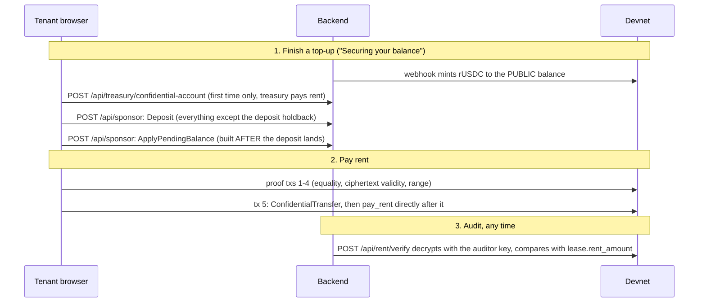

# Contract 7: Private rent payment (workstream F)

How a tenant finishes a top-up privately, pays rent privately, and how a landlord sees it. Read with
`privacy.md` (what is hidden), `program-interface.md` §3 (the transaction layout `pay_rent` demands) and
`treasury.md` / `stripe.md` (where the balance comes from).

## Flow



## Files

| | |
|---|---|
| `app/src/lib/pay.ts` | the flows, no React: `securePrivateBalance`, `enablePrivateReceiving`, `payRentPrivately`, `revealReceived`, `payErrorMessage` |
| `app/src/lib/confidential.ts` | the kit island: added `accountState`, `planDeposit`, `findTransfer`, `transferMessageIndex`, a second payer/submit for account setup, progress callback on `runPlan` |
| `app/src/lib/mint.ts` | asks a mint the question the program asks (does it carry `ConfidentialTransferMint`?) without loading the wasm |
| `app/src/screens/Pay.tsx` | `PaySection` (tenant card / landlord card), `SecurePrivateBalance`, `useConfidentialRent` |
| `backend/src/lease.ts`, `server.ts` | hand-decoded `Lease`; `POST /api/rent/verify` |
| `backend/src/rentpay.ts` | Node-side counterpart of the transfer plan; used by the exit-gate script |
| `scripts/exit-gate.ts` | the devnet gate |

## Rules that are easy to get wrong

- **The deposit stays public.** `securePrivateBalance` takes a `holdback`; everything above it moves. `fund_deposit` spends a public amount, and a tenant whose whole balance went private cannot accept a lease.
- **Apply-pending is built after the deposit lands**, never in the same transaction: it re-encrypts from the account's current state.
- **Account setup uses the treasury route**, not `/api/sponsor`: someone must fund the new account's rent, and the sponsor refuses any instruction that names the fee payer. The setup message must name the **treasury** as fee payer (`GET /health` reports it; the app caches it).
- **`pay_rent` goes directly after the transfer**, spliced in with `spliceAfterTransfer`. Anything between them, including the planner's context-state closes, fails as `MissingConfidentialTransfer`.
- **A landlord's public balance is not swept.** `enablePrivateReceiving` creates the account and moves nothing; the payout screen burns from the public balance.
- **The landlord's amount comes only from decrypting their own balance.** "Payment received" is `paid_count` from the lease account; no figure is ever read from public data.

## `POST /api/rent/verify`

Session required. Body `{ signature, lease }`. The expected amount is read from the lease account on chain, never from the body. Only the lease's tenant or landlord may ask; anyone else gets the same `404 lease-unknown` as for a lease that does not exist. A wrong amount is `200 { ok: false, reason }`; only a failure to perform the audit is an error status. `503` when `RUSDC_AUDITOR_IKM` is unset.

## Exit gate

```
node scripts/exit-gate.ts          # full gate, needs the program on devnet
node scripts/exit-gate.ts --probe  # no program: plans a real rent payment, sends nothing, checks sizes and the sponsor policy
```

Env comes from `../demo/.env`, then `~/.config/relstate/keys/p1-backend.env` on top (non-empty wins). Key paths in the latter point at a removed worktree, so the script falls back to the backups in `~/.config/relstate/keys/`. Nothing secret is printed. It fails fast, exit code 2 and the reason, if the program account is missing. `init_config` (treasury as admin) and `set_mint_allowed` for rUSDC run first and are idempotent.

Measured on devnet with `--probe` (2026-10-10): the rent payment is **5 transactions** of 680, 904, 321, 1207 and 836 bytes. The last carries the transfer and `pay_rent` and fits in 1232 with room to spare.

## Known problems

1. **`/api/sponsor` rejects every transaction of the proof plan.** The planner funds its context-state accounts from the payer, so the fee payer is a writable signer inside instruction 0 (and 2 in the last), which `assertSponsorNotUsedByInstructions` refuses by design. Measured: 5 of 5 rejected. So the app's Pay flow, which submits through `/api/sponsor`, cannot pay rent for a 0-SOL wallet yet. `Deposit` and `ApplyPendingBalance` are unaffected (they do not name the payer). Needs a decision; see the report.
2. **A 0-SOL tenant cannot reach the rent step on their own.** `apply` and `fund_deposit` create the application and the profile with the tenant as rent payer. The gate funds the tenant with account rent and drains them back to 0 SOL before paying.
3. **No USDC reserve account is configured** (`USDC_RESERVE_TOKEN_ACCOUNT` is empty in both env files), so the invariant is checked against the mock ledger.
4. **The devnet program is not deployed.** Deploying is the user's step.
