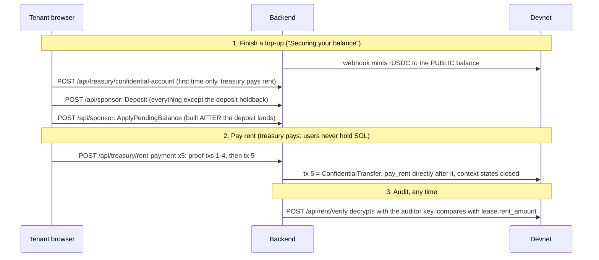

# Contract 7: Private rent payment (workstream F)

How a tenant finishes a top-up privately, pays rent privately, and how a landlord sees it. Read with
`privacy.md` (what is hidden), `program-interface.md` §3 (the transaction layout `pay_rent` demands) and
`treasury.md` / `stripe.md` (where the balance comes from).

## Flow



## Files

| | |
|---|---|
| `app/src/lib/pay.ts` | the flows, no React: `securePrivateBalance`, `enablePrivateReceiving`, `payRentPrivately`, `revealReceived`, `payErrorMessage` |
| `app/src/lib/confidential.ts` | the kit island: added `accountState`, `planDeposit`, `findTransfer`, `transferMessageIndex`, a second payer/submit for account setup, progress callback on `runPlan` |
| `app/src/lib/mint.ts` | asks a mint the question the program asks (does it carry `ConfidentialTransferMint`?) without loading the wasm |
| `app/src/screens/Pay.tsx` | `PaySection` (tenant card / landlord card), `SecurePrivateBalance`, `useConfidentialRent` |
| `backend/src/lease.ts`, `server.ts` | hand-decoded `Lease`; `POST /api/rent/verify` |
| `backend/src/rentpay.ts` | Node-side counterpart of the transfer plan; used by the exit-gate script |
| `scripts/exit-gate.ts` | the devnet gate |

## Users never hold or acquire SOL; the platform provisions rent

Two things cost SOL that the user cannot be asked for, and neither can go through `/api/sponsor`, whose rule (the fee payer never appears inside an instruction) stays absolute. Each has its own treasury-cosigned route with its own bounds.

| Route | Provisions | Why it needs the treasury |
|---|---|---|
| `POST /api/treasury/rent-dust` | the rent of a tenant's `Application` + `Profile` (the program makes the **tenant** their payer in `apply` / `fund_deposit`) | someone must hold the lamports before the user signs |
| `POST /api/treasury/rent-payment` | fee + the rent of the proof context-state accounts of a rent payment, refunded when the plan closes them | the proof plan funds them from the payer, so the payer is inside every transaction (measured: 5 of 5 refused by `/api/sponsor`) |

### `POST /api/treasury/rent-dust`

Session required and bound to the wallet: a body naming another wallet is a 400, not obeyed. Once per wallet; refused (`already-funded`) when the wallet already holds that much; amount is exactly the rent-exempt minimum of the 104-byte Application plus the 88-byte Profile, nothing for fees (the sponsor pays those). A global hourly count and daily lamport cap apply (`RENT_DUST_*`). The app asks for it when the session is registered, best-effort. **Landlords** also need rent (listing, lease, vault, profile) and this does not cover them; the gate funds the landlord directly.

### `POST /api/treasury/rent-payment`

One transaction per call, session required, the session wallet must be the paying tenant. Everything is checked **before** the treasury signs:

- program allowlist: System, Token-2022, ZK ElGamal proof, relstate, ComputeBudget (a test pins the list);
- every other required signature present and cryptographically valid, treasury's slot the only empty one;
- the shape filter (`backend/src/rentshape.ts`), which confines the treasury to exactly these positions and nowhere else:

| Instruction | Allowed | Treasury may appear as |
|---|---|---|
| System | `createAccount` only, new account owned by the ZK proof program, lamports and size capped | funder |
| ZK proof verify (tags 1-12) | yes | context-state **authority** (account 1) only |
| ZK `CloseContextState` | yes, rent must return to the treasury | destination **and** authority |
| Token-2022 | `ConfidentialTransfer` only, source = the wallet's own rUSDC account, mint = rUSDC, signing authority = the wallet | **never** (it is the mint and freeze authority) |
| relstate | `pay_rent` only, tenant = the wallet, directly after the transfer | **never** |

- a simulated spend cap per transaction (a net credit is allowed here because the closing transaction returns the rent; the setup route still refuses one);
- its own per-wallet and global limiter, and a replay guard (the same signed message is not co-signed twice).

Why the treasury as ZK context-state authority is safe, and the alternative is not: that authority can close a context state and do nothing else. If the *client* were the authority they could close an account we funded straight to themselves, outside any route. Because the authority is ours and the close destination is pinned to us, nobody can move that rent.

### Residual risks (for the security review)

1. **Grief, bounded.** A client can have the treasury fund a ZK-owned context account and never use it. With no verify instruction the account has no authority recorded, so its rent is stranded. Bounded per transaction (`RENT_PAYMENT_MAX_CONTEXT_LAMPORTS`, size cap, `RENT_PAYMENT_MAX_CREATE_ACCOUNTS`), per wallet per hour and per day, and globally per day.
2. **Rent dust can be farmed by new sessions.** Once-per-wallet is enforced in memory (a restart forgets it, though `already-funded` then stops a wallet that still holds the grant), and mock auth issues a session to any wallet. Bounded by the global daily cap; real identity (KYC) is what makes it a per-person grant.
3. **Limiters are per process.** Fine for one demo backend; a second instance needs shared state.
4. **The ZK program's authority semantics are assumed**, from its source, not independently verified on chain.

## Rules that are easy to get wrong

- **The deposit stays public.** `securePrivateBalance` takes a `holdback`; everything above it moves. `fund_deposit` spends a public amount, and a tenant whose whole balance went private cannot accept a lease.
- **Apply-pending is built after the deposit lands**, never in the same transaction: it re-encrypts from the account's current state.
- **Account setup and the rent payment use treasury routes**, not `/api/sponsor`: someone must fund the rent, and the sponsor refuses any instruction that names the fee payer. Those messages must name the **treasury** as fee payer (`GET /health` reports it; the app caches it), and the rent plan must be PLANNED with the treasury as payer, because the payer becomes the proof contexts' authority.
- **Each transaction must land before the next is co-signed.** The backend returns when it has *sent*; the plan is a chain of dependent transactions, so the app waits (HTTP polling) between them.
- **`pay_rent` goes directly after the transfer**, spliced in with `spliceAfterTransfer`. Anything between them, including the planner's context-state closes, fails as `MissingConfidentialTransfer`.
- **A landlord's public balance is not swept.** `enablePrivateReceiving` creates the account and moves nothing; the payout screen burns from the public balance.
- **The landlord's amount comes only from decrypting their own balance.** "Payment received" is `paid_count` from the lease account; no figure is ever read from public data.

## `POST /api/rent/verify`

Session required. Body `{ signature, lease }`. The expected amount is read from the lease account on chain, never from the body. Only the lease's tenant or landlord may ask; anyone else gets the same `404 lease-unknown` as for a lease that does not exist. A wrong amount is `200 { ok: false, reason }`; only a failure to perform the audit is an error status. `503` when `RUSDC_AUDITOR_IKM` is unset.

## Exit gate

```
node scripts/exit-gate.ts          # full gate, needs the program on devnet
node scripts/exit-gate.ts --probe  # no program: plans a real rent payment, sends nothing, checks it against the filter
```

Env comes from `../demo/.env`, then `~/.config/relstate/keys/p1-backend.env` on top (non-empty wins). Key paths in the latter point at a removed worktree, so the script falls back to the backups in `~/.config/relstate/keys/`. Nothing secret is printed. It fails fast, exit code 2 and the reason, if the program account is missing. `init_config` (treasury as admin) and `set_mint_allowed` for rUSDC run first and are idempotent.

It drives the backend's own app in-process against devnet, so it exercises the routes the browser calls: rent dust (and its refusals), the five-transaction rent payment through `/api/treasury/rent-payment`, a replay refusal, and `/api/rent/verify`. It then asserts: the tenant ends the lease steps with exactly 0 SOL; the rent is not in the confirmed transaction; the auditor decrypts exactly the rent and rejects a wrong expected amount; the landlord decrypts it with their own key; the treasury only spent fees (the context rent came back); the reserve invariant holds.

Measured on devnet with `--probe`: 5 transactions of 680, 904, 321, 1207 and 836 bytes. The last carries the transfer and `pay_rent`. All five pass the rent-payment filter, and all five would still be refused by `/api/sponsor`.

## Known limits

1. **No USDC reserve account is configured** (`USDC_RESERVE_TOKEN_ACCOUNT` is empty in both env files), so the invariant is checked against the mock ledger.
2. **The devnet program is not deployed.** Deploying is the user's step; the full gate has not run.
3. **Landlord rent is not provisioned** (see rent dust above).
